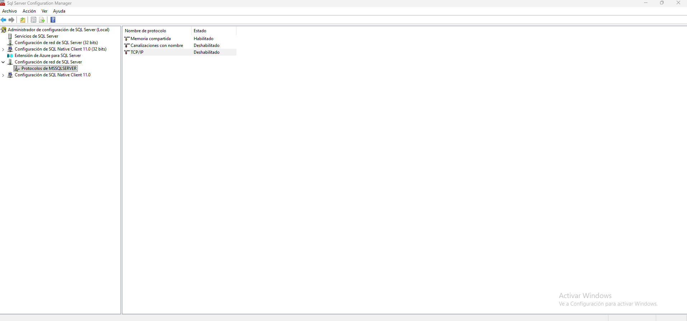

## Introducción

En las ediciones Developer y Express, TCP/IP viene desactivado por defecto tras la instalación. En este caso cualquier cualquier conexin que hagamos a SQL Server no utilizaremos ningun puerto, simplemente con el hostname por ejemplo localhost a secas, la herramienta SQL Server Management Studio, o bien el CLI sqlcmd usa Shared Memory, que es un canal local que no pasa por la red. Si quieremos activarlo para por ejemplo acceder externament a la instancia de SQL Server de la VM, deberemos de arrancar **SQL Server Configuration Manager** atraves del comando `SQLServerManager17.msc` y dentro configurar estos pasos:

1. Panel izquierdo abrir Configuracin de Red de SQL Server -> Protocolos de MSSQLSERVER (o el nombre de tu instancia).
2. Desde la pestaña protocolos del argumento TCP/IP activarla. Doble clic y poner a Si la habilitacin de este argumento desde esta pestaña.
3. Desde la pestaña IP Addresses del argumento TCP/IP, sección IPAll: deja TCP Dynamic Ports vacío y pon TCP Port = 1433.
4. Reinicia el servicio de SQL Server.

