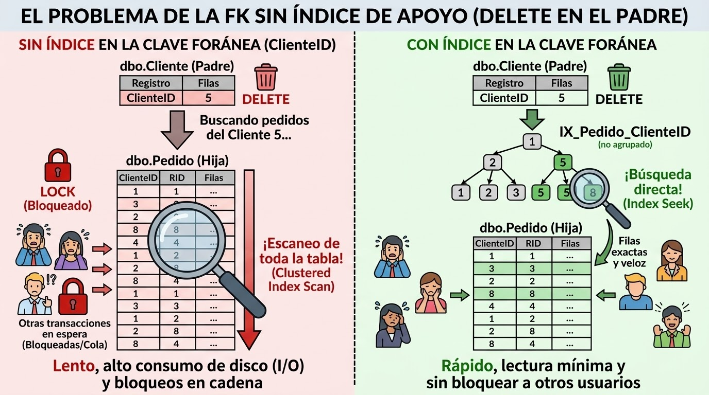

## Introducción

Ejecutar sql con y sin indice y con indice en la columna Total y con indice Total incluyendo todas las columnas
## Ejemplo

- Ejecutar sql script `total-without-index.sql` desde SQL Server Management Studio sin indice alguno y ver el plan. Es el caso mas desfavorable pues no existe indice alguno contra la columna que utilizamos en el discrimante de la consulta.

- Ejecutar sql script `total-index.sql` desde SQL Server Management Studio habiendo creado un indice contra la columna Total, pero sin incluir las columnas que seguimos requiriendo en el select. Aunque podra parecer que este indice ayudaria a crear un mejor plan, la realidad es que al no incluir las columnas en el mismo, resulta mas caro ejecutar la sql con este indice, que hacer un Clustered Index Scan, es decir leer todas la tabla desde el punto estadistico, porque al buscar los pedidos mayores a 990, SQL Server ha calculado estadísticamente cuántas filas van a cumplir esa condición. Como el índice básico no tiene las columnas ClienteID, FechaPedido ni Estado, el motor tendría que hacer un "Key Lookup" (un salto a la tabla original) por cada una de esas filas. El optimizador de SQL Server es lo suficientemente inteligente para darse cuenta de que dar tantos cientos de saltos va a ser más lento que simplemente leer la tabla entera desde el principio.

Si te fijas en la parte superior de tu plan de ejecución, hay un texto de color verde que dice: Falta índice (impacto 74.0981): CREATE NONCLUSTERED INDEX.... SQL Server te está pidiendo a gritos que crees exactamente el Covering Index (el índice con INCLUDE) que comentamos en el laboratorio anterior. El motor sabe que si le das las columnas incluidas, se ahorrará el 74% del esfuerzo

- Ejecutar sql script `total-covering-index.sql` desde SQL Server Management Studio, en este caso modificamos en anterior indice de la columna Total y le añadimos al mismo las columnas que recuperamos en la sql. Ahora si que utiliza el indice pues es el mas optimo estadisticamente, pues ya puede recuperar todos los datos desde el mismo sin tener que ir fila a fila recuperando ninguna columna. nos hemos ahorrado un 74%. Tambien veremos que las lecturas logicas han bajado bastante.

