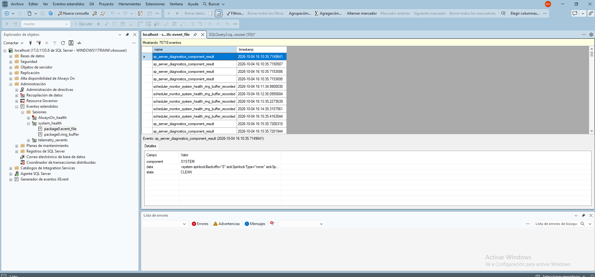

## Introducción

En SQL Server, system_health es una sesión de Eventos Extendidos (Extended Events) que se crea y se ejecuta de forma automática al instalar el motor de base de datos. Su función principal es recopilar información del sistema de manera continua y con muy bajo impacto en el rendimiento, permitiendo diagnosticar problemas graves del servidor sin necesidad de activar trazas manuales o pesadas.
Esta herramienta funciona como una "caja negra" que guarda los datos en un búfer de memoria (ring_buffer) y en archivos físicos en el disco (.xel), ciclando la información para no saturar el almacenamiento.

Qué información registra system_health

- Categoría: Eventos específicos que captura
- Errores Graves: Errores con severidad mayor o igual a 20 (errores críticos del sistema o de hardware).
- Bloqueos Críticos: Interbloqueos (Deadlocks) y los gráficos detallados de los procesos involucrados.
- Problemas de Memoria:	Errores de falta de memoria (Out of Memory) como el error 17803.
- Rendimiento: Esperas excesivas (Letch/Lock waits) y tiempos de espera de consultas agotados (Timeouts).
- Conectividad: Errores de inicio de sesión y desconexiones abruptas de clientes.

## Ejemplo

Imagina que dos usuarios intentan actualizar los mismos datos al mismo tiempo, provocando que sus consultas se bloqueen mutuamente entre sí (un Deadlock). SQL Server elegirá automáticamente a uno de ellos como "víctima" y cancelará su transacción.

Si no tenías ninguna herramienta de monitoreo activa en ese momento, puedes acudir a system_health para recuperar el gráfico del problema con los siguientes pasos:

1. Abre SQL Server Management Studio (SSMS).
2. En el Explorador de Objetos, expande las siguientes carpetas: Administración > Eventos extendidos > Sesiones.
3. Expande la sesión llamada system_health.
4. Haz clic derecho sobre el archivo de destino (normalmente listado como package0.event_file) y selecciona Ver datos en directo (View Target Data).
5. En los filtros o la lista de eventos, busca el evento llamado xml_deadlock_report.
6. Al hacer clic en él, la pestaña inferior Detalles del evento te mostrará el gráfico exacto (en formato XML o visual) indicando qué consultas, usuarios y tablas causaron el conflicto.

También puedes extraer esta información directamente ejecutando una consulta T-SQL `system_health.sql` contra la base de datos del sistema **master**.