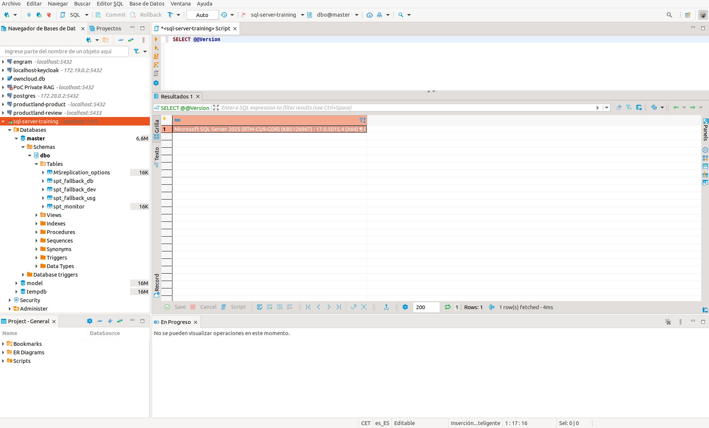

## Introducción

Instancia SQL Server 2025 desde Docker

**Consideraciones al instancias SQL Server como contenedor**

- Dado que estas en Docker, debes configurar tu base de datos en Modo Mixto (Windows y SQL Server).
- Nunca uses Trusted_Connection=True; o Integrated Security=True; en tu archivo de configuración dentro de Docker, porque el contenedor Linux fallará inmediatamente al intentar buscar un dominio de Windows que no conoce.

## Ejemplo

Podemos arrancar directamente SQL Server desde docker CLI:

```shell
# 3. Arrancar SQL Server de verdad (cambia la contraseña)
docker run -d -e ACCEPT_EULA='Y' -e MSSQL_SA_PASSWORD='!Thingtrack2010' -u root -p 1433:1433 --name sql-server-training --hostname sql-server-training -v sqldata:/var/opt/mssql/data -v sqlbackups:/var/opt/mssql/backup mcr.microsoft.com/mssql/server:2025-latest
```

Para evitar arrancar en modo root podemos ejecutar estos comandos para incluir al usuario sql server (10001) y configurar permisos en los volumenes

```shell
# 1. Limpiar el contenedor fallido
docker rm -f sql-server-training

# 2. configurar permisos (control total al usuario sql server y ususarios del grupo root sobre los volumes) y asignar usuario sql server 10001 al grupo de root
docker run --rm -u root \
  -v sqldata:/data -v sqlbackups:/backup \
  alpine sh -c "chown -R 10001:0 /data /backup && chmod -R 775 /data /backup"
```

O bien podemos utilizar docker compose a través de este script `docker-compose.yml`.



**Nota de arquitectura**:
Nunca definir a fuego la clave de sa en el fichero docker compose, sino utilizar un .venv en donde definir la misma y acceder a ella desde el fichero de despliegue.
