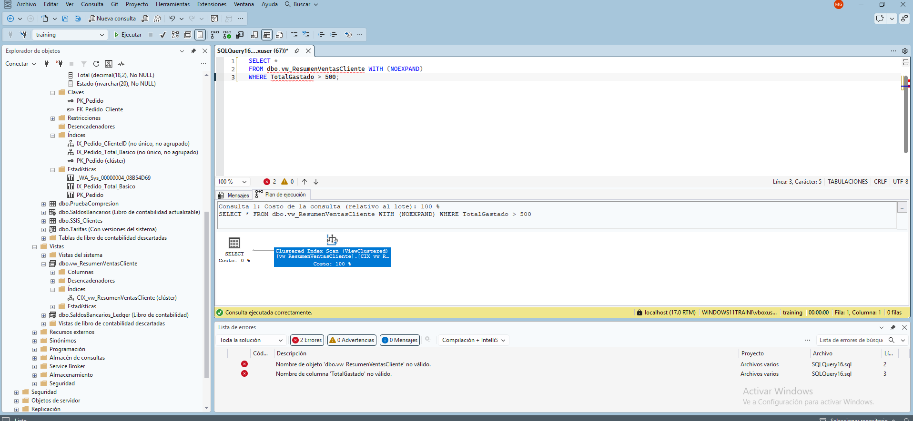

## Introducción

Crear una vista materializada(indexada)

Las Vistas Indexadas (también conocidas como Materialized Views en otros motores) son herramientas sumamente potentes en SQL Server. A diferencia de una vista normal (que es solo una consulta guardada), una vista indexada escribe físicamente los resultados en el disco duro, comportándose como una tabla real.
Para que SQL Server pueda mantener esos datos sincronizados en tiempo real cada vez que las tablas base cambian, impone restricciones matemáticas y estructurales extremadamente estrictas. A continuación, te explico el detalle técnico de cada uno de tus puntos:

1. SCHEMABINDING y nombres de dos partes

• SCHEMABINDING (Vinculación de esquema): Es una cláusula obligatoria al crear la vista. Bloquea las tablas base para proteger la vista. Si alguien intenta alterar o eliminar una columna o tabla que la vista indexada utiliza (por ejemplo, con un ALTER TABLE), SQL Server arrojará un error y detendrá la acción. Esto garantiza que la estructura física indexada nunca se "rompa" por accidente.
• Nombres de dos partes: Dentro del código de la vista, estás obligado a llamar a las tablas especificando siempre su esquema (ejemplo: dbo.Clientes en lugar de solo Clientes). Evita cualquier ambigüedad de resolución de nombres para el motor.

2. COUNT_BIG(*) si hay GROUP BY

Si tu vista indexada realiza agrupaciones (GROUP BY), es obligatorio incluir la función estadística COUNT_BIG(*).
- Por qué es necesario: Si modificas, insertas o eliminas filas en las tablas reales, SQL Server necesita saber exactamente cuántas filas componen cada grupo de la vista para actualizar el almacenamiento físico. Si un grupo se queda con 0 registros debido a un DELETE, el motor usa el contador para saber que debe borrar físicamente esa fila de la vista indexada.
- Por qué COUNT_BIG y no COUNT: COUNT devuelve un tipo de dato INT, mientras que COUNT_BIG devuelve un BIGINT. SQL Server exige este último para evitar desbordamientos numéricos si tus tablas base escalan a miles de millones de registros.

3. Sin OUTER JOIN, subconsultas, DISTINCT, TOP, UNION ni MIN/MAX

Todas estas funciones están estrictamente prohibidas en la definición de una vista indexada porque vuelven el cálculo dinámico de cambios (intersecciones delta) teóricamente infinito o demasiado costoso para el procesador:
- OUTER JOIN (LEFT/RIGHT): Introducen valores NULL artificiales si no hay coincidencia. Si se inserta un dato nuevo en la tabla secundaria, el motor tendría que recalcular filas enteras que antes eran NULL, lo cual arruinaría el rendimiento de escritura de la base de datos.
- DISTINCT y TOP: Rompen la linealidad de las operaciones de conjuntos que SQL Server necesita monitorizar de forma incremental.
- MIN / MAX: Si eliminas la fila que actualmente tiene el valor mínimo, el motor tendría que escanear toda la tabla base desde cero para encontrar el "nuevo mínimo", destruyendo el propósito de rendimiento de la vista.

4. Primer índice: UNIQUE CLUSTERED

No puedes crear índices tradicionales (Non-Clustered) en una vista si no has creado este primero. El índice UNIQUE CLUSTERED es el que materializa la vista: toma los resultados de la consulta, los ordena físicamente y los escribe en las páginas de datos del disco duro. Debe ser obligatoriamente único (UNIQUE) para que SQL Server asocie unívocamente cada fila física de la vista con los registros de las tablas de origen.

5. Opciones SET: ARITHABORT, ANSI_NULLS y QUOTED_IDENTIFIER en ON

Estas opciones de sesión modifican el comportamiento matemático y lógico de las consultas. SQL Server exige rigurosamente que estén activadas (ON) al crear la vista indexada y al insertar datos en las tablas base.
- Si una de estas opciones cambia a OFF, operaciones básicas como evaluar un NULL o manejar una división por cero cambiarían de resultado lógico. Para evitar que la vista guarde datos inconsistentes o corruptos con respecto a la realidad de las tablas, SQL Server arrojará un error de inserción si ejecutas código con estas opciones en OFF.

6. Standard Edition: usar NOEXPAND

Este es uno de los secretos mejor guardados y más críticos sobre el rendimiento de SQL Server:
- En Enterprise Edition: El optimizador tiene un componente llamado "Matching Index View". Si haces una consulta común a las tablas base, el motor detecta automáticamente que ya existe una vista indexada que tiene esos datos listos y la usa en secreto, sin que tú se la pidas.
- En Standard Edition: Este optimizador automático no funciona. Si consultas las tablas base, SQL Server ignorará la vista indexada y calculará todo desde cero. Para obligar a la versión Standard a leer los datos ya procesados del disco duro, debes hacer la consulta apuntando directamente a la vista y añadir la pista (hint) WITH (NOEXPAND). Esto le dice al motor: "No expandas esta vista en su consulta original, léela como si fuera una tabla física"

## ¿Cuándo SÍ indexar una vista y cuándo NO?

Las vistas indexadas (o materializadas) guardan los datos físicamente en el disco. Aunque aceleran las lecturas, penalizan las escrituras. Evalúa tu escenario antes de indexar:

| Escenario de Base de Datos | ¿Indexar la vista? | Razón Técnica |
| :--- | :---: | :--- |
| **Tablas OLTP de alta transaccionalidad** *(Ej: Ventas en vivo, inventario, telemetría o logs)* | ❌ **NO** | El servidor colapsará por sobrecarga de CPU y disco, ya que debe actualizar el índice de la vista en tiempo real con cada `INSERT`, `UPDATE` o `DELETE`. |
| **Agregaciones masivas sobre millones de filas** *(Ej: Consultas recurrentes con `SUM`, `COUNT` o `AVG`)* |  **SÍ** | SQL Server calcula y procesa la operación matemática **una sola vez** al escribir. El `SELECT` posterior lee el resultado ya masticado de forma instantánea. |
| **Entornos de solo lectura o Data Warehouse** *(Ej: Catálogos de productos, históricos, reportes mensuales)* |  **SÍ** | Al no existir penalización por modificación de datos (escrituras), te beneficias al 100% de la velocidad de lectura del índice físico. |
| **Vistas con Joins complejos entre tablas gigantes** *(Ej: Consultas pesadas que cruzan 4 o más tablas grandes)* |  **SÍ** | Evita que el motor tenga que resolver y recalcular el árbol de ejecuciones del `JOIN` cada vez que un usuario hace la consulta. |
| **Vistas simples con filtros básicos** *(Ej: Un filtro `WHERE Activo = 1` o Joins sencillos)* | ❌ **NO** | Es un desperdicio de almacenamiento. Para estos casos, es infinitamente más eficiente y limpio indexar correctamente las columnas en las tablas base. |

---

## Regla de Oro
> Usar **vistas normales** siempre debe ser tu opción por defecto. Opta por una **vista indexada** únicamente cuando una consulta sea críticamente lenta, maneje un volumen masivo de datos, realice cálculos costosos y las tablas base cambien con relativa **poca frecuencia**.

## Ejemplo

Ejecutar sql script `view.sql` desde SQL Server Management Studio y observar el plan utilizado, es decir, el indice creado para acelerar la busqueda en la misma.

