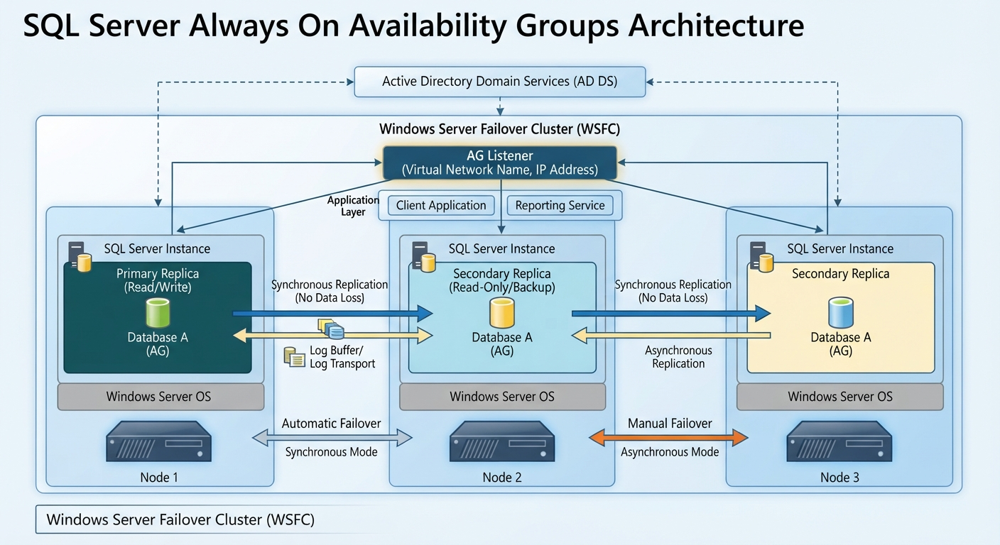

## Introducción

Always On Availability Groups (AG) es una solución avanzada de alta disponibilidad y recuperación ante desastres en SQL Server orientada a conjuntos de bases de datos

## Características principales

- Arquitectura: Consta de 1 réplica principal (lectura/escritura) y de 1 a 8 réplicas secundarias (para lectura o copias de seguridad).
- Modos de confirmación:
    - Sincrónica: Prioriza la protección de datos (sin pérdida de datos, con mayor latencia).
	- Asincrónica: Prioriza el rendimiento (menor latencia).
- Infraestructura base: Requiere un clúster de conmutación por error como Windows Server Failover Clustering (WSFC) o Linux Pacemaker (aunque existen alternativas de despliegue específicas).
- Tipos de conmutación (Failover): Puede ser automática (en modo síncrono), manual planificada o forzada (con posible pérdida de datos)

## Arcquitectura

A continuación se detalla una tabla con el resumen de la función de cada componente presente en el diagrama de arquitectura de Always On Availability Groups:

| Componente | Función Principal |
| :--- | :--- |
| **Active Directory Domain Services (AD DS)** | Gestiona la autenticación, las identidades de red y los permisos de seguridad centralizados para todos los nodos y cuentas de servicio del entorno. |
| **Windows Server Failover Cluster (WSFC)** | Infraestructura del sistema operativo que supervisa la salud de los servidores, coordina la comunicación interna y gestiona el mecanismo de conmutación por error (*failover*). |
| **AG Listener (Oyente)** | Nombre de red virtual e dirección IP única a la que se conectan las aplicaciones. Enruta el tráfico automáticamente hacia la réplica principal activa sin que el cliente sepa qué servidor físico está respondiendo. |
| **Client Application / Reporting Service** | Capa de aplicación de los usuarios. Las aplicaciones transaccionales van a la réplica de lectura/escritura, mientras que los reportes pueden redirigirse a las réplicas secundarias de solo lectura para liberar carga. |
| **Primary Replica (Node 1)** | Nodo activo que aloja las bases de datos en modo lectura y escritura. Recibe todas las transacciones de producción y coordina el envío de los registros de transacciones (*logs*) hacia las réplicas secundarias. |
| **Secondary Replica (Node 2 - Synchronous)** | Copia exacta que recibe los cambios de forma síncrona. Garantiza que **no haya pérdida de datos** y permite habilitar la **conmutación por error automática** si el Nodo 1 falla. Puede usarse para lectura o backups. |
| **Secondary Replica (Node 3 - Asynchronous)** | Copia que recibe los cambios de forma asíncrona para no afectar el rendimiento del nodo principal. Ideal para escenarios de **recuperación ante desastres (DR)** geográficamente distantes; su conmutación es manual. |
| **Database A (AG)** | Base de datos de usuario configurada bajo el modelo de recuperación completa (*Full Recovery*) que forma parte del grupo de disponibilidad y se replica entre todos los nodos participantes. |
| **Log Buffer / Log Transport** | Mecanismo encargado de capturar los bloques del registro de transacciones en la réplica principal y transmitirlos a través de la red hacia los nodos secundarios para su posterior aplicación (*Redo*). |
| **Windows Server OS** | Sistema operativo base instalado en el hardware o máquina virtual de cada uno de los nodos individuales (Nodo 1, Nodo 2 y Nodo 3). |

