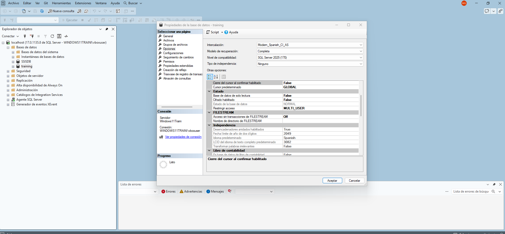

## Introducción

Un administrador de bases de datos debe decidir al crear una base de datos: el Modelo de Recuperación. Este ajuste dicta cómo SQL Server gestiona el archivo de registro de transacciones (.ldf) y, por tanto, hasta qué punto puedes recuperar los datos tras un desastre.

1. Modelo Simple (Simple):

Es el modelo de menor mantenimiento, ideal para entornos donde perder datos recientes no es crítico o pueden volver a generarse. Su uso típico son los entornos de desarrollo o bases de datos analíticas (DWH recargable).   

- Truncado y Cadena (Log chain): En este modelo, el motor recicla el espacio del archivo de log de forma automática en cada checkpoint. Debido a esto, el historial continuo se destruye, la cadena de log no existe, y SQL Server no te permite ejecutar el comando BACKUP LOG.
- Restauración: Como no hay copias de seguridad del log, si el servidor se cae a las 14:00, tu única opción es restaurar el último backup Full o Diferencial que hiciste la noche anterior, perdiendo todas las ventas del día. 
- Rendimiento: Aplica minimal logging en operaciones masivas, lo que hace que las importaciones de datos sean extremadamente rápidas porque no registra fila por fila.   

2. Modelo Completo (Full):

Es el estándar absoluto y obligatorio para bases de datos transaccionales (OLTP en producción), como una tienda online real donde perder un solo pedido es inaceptable.   

- Truncado y Cadena: SQL Server no borra nada del log automáticamente. El truncado ocurre sólo tras ejecutar explícitamente un BACKUP LOG. Esto obliga al DBA a programar backups del log frecuentes (ej. cada 15 minutos) para mantener una cadena continua y evitar que el disco duro se llene. 
- Restauración: Gracias a esta cadena continua, puedes hacer una restauración a cualquier instante exacto usando STOPAT. Si un usuario borra la tabla Pedido a las 11:45:30, puedes restaurar la base de datos exactamente a las 11:45:29.
- Rendimiento: Su desventaja es que realiza un registro completo de cada operación masiva. Si importas un millón de filas, SQL Server escribe un millón de registros en el log, lo que consume mucha CPU e I/O de disco. 

3. Modelo Bulk-Logged (Optimizado para cargas masivas):

Es un modelo híbrido diseñado para utilizarse de forma temporal durante ventanas ETL puntuales (procesos de carga masiva de datos durante la madrugada).   

- Truncado y Cadena: Funciona igual que el modelo Full; requiere backups del log obligatorios y el truncado ocurre sólo tras ejecutar un BACKUP LOG.
- Operaciones Masivas: Su gran ventaja frente al modelo Full es que aplica minimal logging a nivel de extensiones de disco (extents) durante las importaciones pesadas, acelerando drásticamente la carga de datos sin llenar el disco.
- Restauración: La limitación es que puedes restaurar a cualquier instante de tiempo, salvo si intentas detenerte dentro de un backup de log que contiene esa operación de carga masiva. En ese caso, debes restaurar el bloque entero de transacciones.

## Ejemplo

Depende del tipo de desastre (si el archivo físico .ldf sigue vivo o no).

Aquí es donde entra el as en la manga de SQL Server, un concepto llamado Tail-Log Backup (Copia de seguridad de la cola del registro). Vamos a ver los dos escenarios reales a los que te enfrentarás:

1. Escenario 1: El error humano (El archivo .ldf está intacto)

Imagina que tu último backup del log programado se ejecutó a las 11:30:00. A las 11:45:30 un desarrollador júnior ejecuta un DROP TABLE Pedido por accidente.

A simple vista, tu lógica es correcta: te faltan 15 minutos en tus archivos de backup. Sin embargo, todas las ventas que entraron en esos 15 minutos siguen escritas físicamente dentro del archivo activo .ldf de tu servidor. El disco duro está perfecto, solo se ha borrado una tabla lógicamente.

En este caso, ¡sí puedes recuperar hasta las 11:45:29! El administrador actúa rápidamente siguiendo estos pasos:

- El rescate de la cola (Tail-Log Backup): Ejecuta inmediatamente un comando de emergencia: BACKUP LOG Ventas TO DISK = '...' WITH NORECOVERY;. Esto entra al archivo .ldf activo, "rescata" esos 15 minutos perdidos (incluyendo la transacción destructiva del borrado) y pone la base de datos en estado de restauración.
- Restaura el backup Full de la noche anterior.
- Restaura el backup del log de las 11:30:00.
- Restaura ese Tail-Log que acaba de salvar, añadiéndole la orden mágica: STOPAT = '2026-10-13 11:45:29'.

El motor reproduce la película y se detiene un segundo antes del desastre. Has recuperado todo.

2. Escenario 2: El desastre físico (El disco del .ldf se quemó)**

Aquí tienes toda la razón. Si a las 11:45:30 el disco duro del servidor falla catastróficamente o hay un apagón que corrompe los archivos físicos, la "cola" del registro se ha volatilizado.

En este escenario, no hay Tail-Log que valga. Tu única salvación son los archivos de backup (.trn) que ya habías sacado de esa máquina. Como tu último BACKUP LOG fue a las 11:30:00, has perdido irremediablemente los últimos 15 minutos y 30 segundos de ventas.

## Otro ejemplo Platilla

Fallo el miércoles a las 10:37. Restauramos el Full del domingo (NORECOVERY), el diferencial del martes
(NORECOVERY), los logs del martes 22:15 al miércoles 10:30 (NORECOVERY) y el último con STOPAT 10:36 y RECOVERY. Cualquier log que
falte interrumpe la secuencia.

```sql
USE master;
GO

-- PASO 1: Restaurar el backup Full del Domingo
-- Se usa NORECOVERY porque sabemos que vamos a apilar más cosas.
RESTORE DATABASE Ventas 
FROM DISK = 'C:\Backups\Ventas_Full_Domingo.bak' 
WITH NORECOVERY, REPLACE;
GO

-- PASO 2: Restaurar el backup Diferencial del Martes
-- Sobrescribe los cambios desde el domingo hasta el martes.
-- Se sigue usando NORECOVERY porque faltan los logs del miércoles.
RESTORE DATABASE Ventas 
FROM DISK = 'C:\Backups\Ventas_Diff_Martes.bak' 
WITH NORECOVERY;
GO

-- PASO 3: Restaurar los backups de Log intermedios (Martes 22:15 a Miércoles 10:30)
-- IMPORTANTE: Para los logs, el comando cambia de RESTORE DATABASE a RESTORE LOG
-- Si hay varios archivos, se restauran uno por uno en orden cronológico, todos con NORECOVERY.
RESTORE LOG Ventas 
FROM DISK = 'C:\Backups\Ventas_Log_Martes_Noche.trn' 
WITH NORECOVERY;

RESTORE LOG Ventas 
FROM DISK = 'C:\Backups\Ventas_Log_Miercoles_Manana.trn' 
WITH NORECOVERY;
GO

-- PASO 4: El último Log y el viaje en el tiempo (STOPAT)
-- Aquí usamos RECOVERY para abrir la base de datos finalmente.
-- El formato de STOPAT es 'YYYY-MM-DD HH:MM:SS'
RESTORE LOG Ventas 
FROM DISK = 'C:\Backups\Ventas_Log_Miercoles_Desastre.trn' 
WITH STOPAT = '2026-10-14 10:36:00', RECOVERY;
GO
```

## Comandos
Para modificar el tipo de recovery de la db podemos ejecutar este comando T-SQL:

```sql
USE master;
GO

-- Cambiar la base de datos al modelo Simple
ALTER DATABASE Ventas 
SET RECOVERY SIMPLE;
GO

-- Cambiar la base de datos al modelo Full
ALTER DATABASE Ventas 
SET RECOVERY PULL;
GO
```



## Truncado del log

En SQL Server, truncar el log no significa reducir el tamaño físico del archivo .ldf en el disco duro, sino "vaciar" lógicamente su espacio interno para que pueda ser reutilizado.

Para entenderlo, imagina el archivo de registro de transacciones como un aparcamiento circular dividido en pequeños bloques lógicos llamados Virtual Log Files (VLFs). Cuando los usuarios hacen operaciones, SQL Server va aparcando los registros en estos bloques uno tras otro.

El truncado es el proceso matemático mediante el cual el motor hace lo siguiente:

- Verifica el estado: Comprueba qué bloques (VLFs) contienen transacciones antiguas que ya han sido confirmadas y aseguradas (ya sea en el disco de datos o en una copia de seguridad).
- Libera el espacio: Marca esos bloques como Inactivos.
- Recicla: Al estar inactivos, el motor sabe que, cuando llegue al final del archivo, puede volver a dar la vuelta y sobrescribir esos bloques viejos con datos nuevos.

**El peligro de no truncar:**

Si los bloques nunca se marcan como inactivos, el aparcamiento se llena. Cuando esto ocurre, SQL Server no puede sobrescribir nada y se ve obligado a pedirle más espacio a Windows, haciendo que el archivo .ldf crezca físicamente (Auto-Growth). Si el log no se trunca regularmente, crecerá hasta llenar por completo el disco duro del servidor, paralizando la base de datos.

Cómo se dispara este truncado (según el Modelo de Recuperación):

- En **Modelo Simple**, SQL Server realiza este truncado de forma automática en segundo plano cada pocos minutos (durante el proceso interno llamado Checkpoint).
- En **Modelo Full**, SQL Server prohíbe el truncado automático. Los bloques se quedan marcados como "Activos" indefinidamente. La única acción en el mundo que trunca el log en este modelo es ejecutar el comando `BACKUP LOG`. (Nota importante: Hacer un backup "Full" de la base de datos no trunca el log de transacciones).

Un error muy común es asumir que al truncar el log recuperarás gigabytes en tu disco duro. Si tu archivo .ldf creció hasta los 50 GB por una mala configuración, truncarlo simplemente lo dejará vacío por dentro (99% de espacio libre para futuras transacciones), pero el archivo seguirá pesando 50 GB en Windows. Para encogerlo físicamente y devolverle ese espacio al sistema operativo, el administrador debe ejecutar un comando completamente distinto llamado `DBCC SHRINKFILE`

## Resumen

"El modelo Full te permite viajar en el tiempo al segundo exacto, siempre y cuando el archivo de log sobreviva para contarlo. Si el hardware muere, retrocederás implacablemente a la hora de tu último backup de log". Por eso las empresas configuran backups de log cada 5 o 10 minutos.