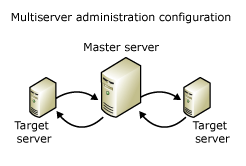
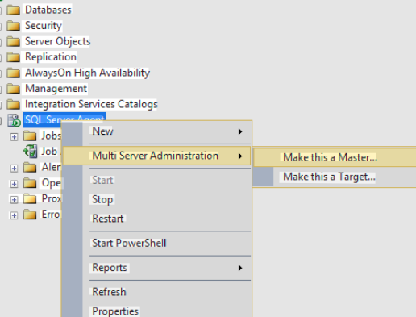

## Introducción

La arquitectura de Servidores Maestros (MSX) y Servidores Destino (TSX) en SQL Server es un modelo de administración multiservidor integrado en el SQL Server Agent. Permite centralizar la gestión de trabajos (jobs) y tareas automatizadas en un único servidor principal para distribuirlos y ejecutarlos de manera organizada en múltiples servidores de la red.

Resumen de la Arquitectura MSX/TSX

Esta estructura se basa en dos roles principales:
- Servidor Maestro (MSX): Es el servidor central. En él se definen, almacenan y controlan todos los trabajos que se quieren replicar. También recibe e integra los eventos o estados de ejecución de las tareas que ocurren en los servidores de destino.
- Servidor Destino (TSX): Es cualquier instancia de SQL Server que se ha enlistado (enlisted) o subordinado a un servidor maestro. El TSX se comunica periódicamente con el MSX a través de un proceso de sondeo (polling) para descargar nuevos trabajos asignados, ejecutarlos localmente y devolver los resultados del estado de la operación.

Beneficios principales:

1. **Administración centralizada**: Evita tener que crear de forma manual el mismo trabajo (como un backup diario) en cada uno de tus servidores individuales.
2. **Escalabilidad**: Ideal para entornos empresariales con decenas o cientos de bases de datos distribuidas.
3. **Seguridad simplificada**: Utiliza cifrado y conexiones controladas a través de cuentas de servicio del Agente de SQL Server.

